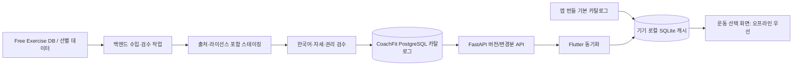

# CoachFit 운동 API 도입 조사

## 요약 및 결론

CoachFit은 이미 FastAPI의 운동 목록 API와 데이터베이스 시드를 갖고 있지만, 현재 시드 목록은 코드상 23개로 작고, Flutter 운동 선택 화면은 서버에서 목록을 가져오지 못하면 오류 화면을 보여준다. 별도의 한국어 운동 가이드 33개가 앱 코드에 있지만, 이는 선택 가능한 운동 카탈로그와 별도이며 안내용 GIF는 외부 CDN에 의존한다.[^1][^2][^3]

**권장안은 사용자가 운동할 때마다 외부 API를 호출하지 않고, 허용된 운동 데이터를 사전에 검수해 CoachFit DB에 가져온 뒤 앱에도 오프라인 카탈로그를 두는 것**이다. 시작 데이터 후보로는 Free Exercise DB가 가장 단순하다. 현재 확인된 데이터는 876개이고 그중 111개가 `body only` 장비로 분류돼 있으며, 설명과 이미지 경로를 제공한다. 다만 한국어 콘텐츠는 별도 번역·검수가 필요하고, 저장소 라이선스가 각 이미지의 권리까지 증명하지는 않는다.[^4][^5]

wger는 맨몸 분류와 운동 설명을 보완할 후보지만 데이터마다 라이선스·저작자 정보가 다르며, 현재 공개 API에서 한국어 운동 번역이 확인되지 않았다. API Ninjas는 단계별 설명과 안전 정보가 장점이지만, 상업적 사용은 유료 구독 조건에 묶이고 로컬 저장은 Business 이상으로 제한돼 있어 영구 오프라인 카탈로그의 기반으로 권하기 어렵다.[^6][^7]

따라서 **API를 런타임 필수 의존성으로 붙이지 말고, Free Exercise DB를 텍스트 중심으로 수입·검수하고, CoachFit이 한국어 명칭과 안전한 자세 설명을 직접 검수하는 방식**을 우선 추천한다. 이미 있는 33개 가이드와 중복을 정리하고, 안정적인 운동 ID와 출처·라이선스 정보를 저장한 다음 Flutter에 캐시/번들 카탈로그를 추가하면 오프라인에서도 운동 선택이 가능하다.[^1][^2][^8]

## CoachFit 현재 구조

조사 기준 저장소 `kang3019/coach-fit`의 `main` 커밋은 `a5f292f4bbd30722bd596354a5373c598bdd81ba`다.[^1]

| 항목 | 확인된 상태 |
|---|---|
| 운동 마스터 | SQLAlchemy `ExerciseMaster`에 이름, 영문 이름, 카테고리, 장비, 타겟 근육, 이미지 URL, 설명 문자열이 있다. 단계별 설명 배열, 로캘, 출처·라이선스 필드는 없다.[^1] |
| 현재 운동 수 | `seed_exercise_masters`의 실제 생성자는 23개다. 주석/엔드포인트 설명에는 24 또는 25개라고 적혀 있어 설명과 코드가 불일치한다. 이것은 코드 시드 수이며, 실행 중 DB의 현재 행 수는 별도 확인하지 않았다.[^1] |
| 백엔드 API | `GET /api/exercises`는 카테고리와 검색어를 받으며, 서비스가 DB 마스터를 필터링해 반환한다.[^1] |
| DB | 설정 URL을 사용하며 개발 기본값은 SQLite다. 프로젝트에는 PostgreSQL 연결 구성이 있다.[^1] |
| 앱의 로딩 | Flutter의 운동 선택 창은 열릴 때 API에서 목록을 받아 위젯 메모리에 보관하고 필터링한다. 요청 실패 시 재시도 오류를 표시하며 영속 캐시 폴백은 이 흐름에서 확인되지 않았다.[^2] |
| 별도 자세 가이드 | 앱의 `exercise_guide_data.dart`에는 한국어 가이드 33개가 정적으로 있다. 운동 선택 마스터와 분리돼 있고, 일부 GIF는 외부 CDN에서 가져온다.[^3] |
| 운동 기록 연결 | 기존 운동 기록은 운동 카탈로그 ID 대신 `exercise_name` 문자열을 저장한다. 기존 기록을 보존하려면 새 안정 ID를 추가하더라도 기존 이름을 스냅샷으로 유지하는 편이 안전하다.[^8] |

## 후보 데이터 비교

| 후보 | 수량·맨몸 | 자세 정보·미디어 | 한국어 | 라이선스·비용·제한 | 판단 |
|---|---|---|---|---|---|
| **Free Exercise DB** | 조사 시점 876개, `equipment: "body only"` 111개.[^4] | `instructions` 문자열 배열과 이미지 경로 제공. 871개에 설명이 있었고 1,746개 이미지 참조를 확인했다. 동영상 필드는 없다.[^4] | 데이터는 영어이며 한국어 제공은 확인되지 않음.[^4] | 저장소는 Unlicense/공개 도메인이라고 표시한다. 하지만 스키마와 저장소에는 각 사진의 출처·권리가 개별 기록되어 있지 않아 사진 사용 허가까지 확정할 수 없음.[^5] | **초기 텍스트 카탈로그 후보로 추천.** 이미지/GIF는 별도 권리 확인 전 수입하지 않는다. |
| **wger API** | 라이브 API 조사 시 920개, `none (bodyweight exercise)` 장비로 272개.[^6] | 설명은 번역 레코드의 텍스트 설명 형태. 이미지/동영상은 존재하지만 모든 운동에 제공되는 것은 아니며, 단계가 정형화됐는지와 지도 품질은 일괄 보장되지 않음.[^6] | 언어 목록에는 한국어가 있지만 `language__code=ko`로 조회한 운동은 조사 시점 0개.[^6] | 운동·번역·이미지·영상별 라이선스/저작자 정보가 다를 수 있어 개별 보존과 검토가 필요. 공개 GET 동작은 확인했지만 서비스 SLA와 명확한 가격 보장은 확인 불가.[^6] | 선별 보완 자료로 검토 가능. 한국어 해결책은 아니고 라이선스 관리 부담이 있다. |
| **API Ninjas Exercises API** | 공식 페이지는 3,000개 이상을 광고하지만 bodyweight 전용 필드/정확한 맨몸 수는 확인 불가.[^7] | 단계별 instructions와 safety 정보 제공. 사진은 프리미엄 기능.[^7] | 한국어 지원이나 로캘 필드는 확인되지 않음.[^7] | Free는 개인·비상업 목적 제한 및 결과 공유 제한. Business 이상에서 캐싱이 허용된다고 가격표에 표시되지만, 구독 종료 후 상업적 결과 사용을 중단해야 하는 약관이 있다. 현재 달러 가격과 오프라인 앱 배포 범위는 확인 불가.[^7] | 유료 온라인 기능 후보일 수 있으나 CoachFit의 영구 로컬 카탈로그 기반으로는 부적합. |
| **ExerciseDB on RapidAPI** | 확인 불가 | 확인 불가 | 확인 불가 | 조사에서 공식 라이선스·쿼터·재배포 권리를 충분히 확인하지 못함. | 권리와 조건을 제공자에게 확인하기 전 채택하지 말 것. |

### 자세 설명 및 이미지에 관한 주의

데이터에 설명이 존재한다는 것만으로 올바르고 안전한 코칭 콘텐츠라고 보장되지는 않는다. 맨몸·기구별 동작 설명을 한국어로 번역하고, 관절 정렬·호흡·주의사항을 사람에게 검수받아야 한다. Free Exercise DB의 공개 라이선스 표시는 데이터셋 자체에 대한 것이며 각 이미지 자산의 권리를 자동으로 확인해 주지 않는다.[^4][^5]

CoachFit의 현재 가이드가 참조하는 `omercotkd/exercises-gifs` 저장소 README는 원본 콘텐츠의 소유자가 아니며 Kaggle 데이터를 미러링한다고 설명한다. 따라서 그 저장소의 MIT 라이선스만으로 개별 GIF 재배포 권리를 결론내릴 수 없다. 이미지가 필요하면 별도 권리 확인 전에는 텍스트와 자체/허가된 그림 또는 중립 플레이스홀더를 쓰는 것이 안전하다.[^9]

## 권장 데이터 흐름

이 방식은 새로운 외부 API가 다운되거나 네트워크가 없어도 사용자가 이미 설치된 앱의 운동 목록을 볼 수 있게 한다. 이는 **운동 카탈로그 열람 오프라인 지원**에 대한 설계이며, 운동 기록의 오프라인 저장·서버 동기화까지 자동으로 해결한다는 뜻은 아니다.[^2][^8]

권장 구현 단계:

1. **중복 정리:** 기존 23개 DB 운동과 33개 앱 가이드를 이름·별칭으로 대조한다. 이름 변경이 과거 기록을 망가뜨리지 않게 과거의 `exercise_name`은 유지한다.[^1][^3][^8]
2. **수입 원본 고정:** Free Exercise DB를 특정 Git 커밋으로 고정해 수입하고, 원본 ID·버전/커밋·원본 URL·수입 시각·라이선스 URL·저작자 정보를 저장한다. 이미지 권리가 검증되지 않은 레코드는 이미지 없이 넣는다.[^4][^5]
3. **단계별 검수:** 영어 명칭을 한국어로 번역하고, 맨몸/소도구/헬스장 필터와 부위·난이도·주의사항을 편집한다. 원본 설명과 CoachFit 검수 설명을 구분한다.
4. **스키마 보완:** 안정적인 CoachFit UUID, 로캘별 이름/별칭, 정렬된 자세 단계, 주의사항, 장비/부위 분류, 검수 상태, 출처·라이선스 메타데이터를 모델링한다. 기존 `instructions`를 즉시 깨뜨리지 않도록 API 버전 호환을 고려한다.[^1]
5. **오프라인 읽기:** 서버가 승인된 카탈로그 버전과 변경분을 제공하고 Flutter는 시작 시 로컬 SQLite에서 즉시 표시한다. 앱에 작은 번들 기본 카탈로그를 포함하고, 서버 동기화는 백그라운드에서 수행한다. 업데이트는 검증 후 한 번에 반영하고, 실패하면 마지막 정상 캐시를 계속 사용한다.[^2]
6. **콘텐츠 릴리스 운영:** 원본 갱신마다 자동 덮어쓰지 않고 변경·라이선스 검사와 사람 검수를 거친 뒤 버전으로 배포한다. 이미지마다 별도 권리와 크레딧 정보를 확인한다.[^5][^6]

## 결론

**운동 API를 도입하는 것이 아니라, 운동 데이터 소스를 골라 앱의 자체 카탈로그로 가져오는 방향이 적합하다.** 우선 Free Exercise DB의 텍스트 데이터를 후보로 삼고, 기존 가이드와 합쳐 맨몸 운동의 한국어 설명을 검수해 DB에 수입한다. 이미지 권리는 따로 증명되지 않으므로 초기에는 사용하지 않는 편이 낫다. wger는 라이선스를 개별 관리할 수 있을 때만 보완 소스로 사용하고, API Ninjas는 지속 유료 구독 및 결과 사용 제한을 받아들일 때만 별도 검토한다.[^4][^5][^6][^7]

이 접근은 호출료·외부 장애에 대한 의존을 줄이고 운동 목록을 오프라인에서도 보여주지만, 번역과 자세 검수 작업은 필요하다. 우선 앱 사용성을 빠르게 개선하려면, 현재 있는 33개 가이드와 23개 마스터 운동을 대조해 누락된 맨몸 운동을 먼저 추가하고, 그 후 라이선스가 명확한 대량 데이터를 검토하는 것이 실용적이다.[^1][^2][^3]

## 신뢰도 및 한계

- **높은 확신:** CoachFit 소스의 모델·API·앱 fetch 흐름과 소스상의 23개/33개 수량, Free Exercise DB의 특정 시점 스냅샷 수량 및 필드 구조.
- **시점 의존:** wger 라이브 API의 총수/언어 분포. 조사 시점의 920개와 한국어 결과 0개는 바뀔 수 있다.
- **법률적 판단 아님:** 라이선스 해석은 공식 저장소/약관에 표시된 문구를 요약한 것이며, 개별 이미지 권리나 배포 방식의 법률 자문을 대체하지 않는다.
- **확인 불가:** ExerciseDB의 재배포 권리·쿼터, wger의 호스팅 SLA·비용 보장, API Ninjas의 현재 달러 가격과 오프라인 결과 배포 범위, 후보 데이터의 전문 트레이너 검수 품질.
- 소스 코드를 조사했지만 실행 중인 백엔드/DB에 접속하지 않았다. 따라서 시드 레코드 수는 현재 라이브 DB 행 수를 뜻하지 않는다.

## 각주

[^1]: CoachFit 모델/시드/API 및 DB: [exercise_db.py:5-18](https://github.com/kang3019/coach-fit/blob/a5f292f4bbd30722bd596354a5373c598bdd81ba/python-ai-backend/app/models/exercise_db.py#L5-L18), [exercise_service.py:28-54](https://github.com/kang3019/coach-fit/blob/a5f292f4bbd30722bd596354a5373c598bdd81ba/python-ai-backend/app/services/exercise_service.py#L28-L54), [exercise_service.py:45-264](https://github.com/kang3019/coach-fit/blob/a5f292f4bbd30722bd596354a5373c598bdd81ba/python-ai-backend/app/services/exercise_service.py#L45-L264), [main.py:228-241](https://github.com/kang3019/coach-fit/blob/a5f292f4bbd30722bd596354a5373c598bdd81ba/python-ai-backend/app/main.py#L228-L241), [database.py:9-26](https://github.com/kang3019/coach-fit/blob/a5f292f4bbd30722bd596354a5373c598bdd81ba/python-ai-backend/app/database.py#L9-L26).
[^2]: Flutter fetch/cache 흐름: [workout_service.dart:15-40](https://github.com/kang3019/coach-fit/blob/a5f292f4bbd30722bd596354a5373c598bdd81ba/mobile-app/lib/services/workout_service.dart#L15-L40), [exercise_picker_modal.dart:58-90](https://github.com/kang3019/coach-fit/blob/a5f292f4bbd30722bd596354a5373c598bdd81ba/mobile-app/lib/screens/widgets/exercise_picker_modal.dart#L58-L90).
[^3]: 로컬 가이드·이미지 사용: [exercise_guide_data.dart:7-34](https://github.com/kang3019/coach-fit/blob/a5f292f4bbd30722bd596354a5373c598bdd81ba/mobile-app/lib/data/exercise_guide_data.dart#L7-L34), [exercise_guide_data.dart:37-564](https://github.com/kang3019/coach-fit/blob/a5f292f4bbd30722bd596354a5373c598bdd81ba/mobile-app/lib/data/exercise_guide_data.dart#L37-L564), [exercise_guide_data.dart:566-577](https://github.com/kang3019/coach-fit/blob/a5f292f4bbd30722bd596354a5373c598bdd81ba/mobile-app/lib/data/exercise_guide_data.dart#L566-L577).
[^4]: [Free Exercise DB README](https://github.com/yuhonas/free-exercise-db/blob/f00c92c7dcf1216a928a52c3706c7ce8e2f71ed5/README.md#L12-L38), [schema](https://github.com/yuhonas/free-exercise-db/blob/f00c92c7dcf1216a928a52c3706c7ce8e2f71ed5/schema.json#L12-L18), [combined exercise data](https://github.com/yuhonas/free-exercise-db/blob/f00c92c7dcf1216a928a52c3706c7ce8e2f71ed5/dist/exercises.json).
[^5]: [Free Exercise DB license](https://github.com/yuhonas/free-exercise-db/blob/f00c92c7dcf1216a928a52c3706c7ce8e2f71ed5/LICENSE.md#L1-L14), [schema instruction/image fields](https://github.com/yuhonas/free-exercise-db/blob/f00c92c7dcf1216a928a52c3706c7ce8e2f71ed5/schema.json#L109-L149). The schema has no per-asset license/source field.
[^6]: [wger exercise info API](https://wger.de/api/v2/exerciseinfo/?format=json&limit=1), [Korean-filtered API result](https://wger.de/api/v2/exerciseinfo/?format=json&language__code=ko&limit=1), [equipment API](https://wger.de/api/v2/equipment/?format=json&limit=100), [wger API serializer source](https://github.com/wger-project/wger/blob/d09dd5e50e7dbeafe492b1a9b7c5cb1f1e89c73e/wger/exercises/api/serializers.py#L410-L445), [media serializer](https://github.com/wger-project/wger/blob/d09dd5e50e7dbeafe492b1a9b7c5cb1f1e89c73e/wger/exercises/api/serializers.py#L196-L229).
[^7]: [API Ninjas Exercises API](https://api-ninjas.com/api/exercises), [Terms of Service](https://api-ninjas.com/tos), [pricing](https://api-ninjas.com/pricing).
[^8]: CoachFit workout stores exercise name as text: [workout_db.py:6-21](https://github.com/kang3019/coach-fit/blob/a5f292f4bbd30722bd596354a5373c598bdd81ba/python-ai-backend/app/models/workout_db.py#L6-L21), [schemas.py:10-34](https://github.com/kang3019/coach-fit/blob/a5f292f4bbd30722bd596354a5373c598bdd81ba/python-ai-backend/app/models/schemas.py#L10-L34).
[^9]: [existing GIF references in CoachFit](https://github.com/kang3019/coach-fit/blob/a5f292f4bbd30722bd596354a5373c598bdd81ba/mobile-app/lib/data/exercise_guide_data.dart#L15-L37), [GIF mirror README](https://github.com/omercotkd/exercises-gifs#readme), [repository license](https://github.com/omercotkd/exercises-gifs/blob/main/LICENSE).
